# EchoNet-Dynamic: MatFPCA of cardiac ultrasound videos

The design is in `PLAN.md`. This file records **what has been run and what
came out**. It is updated after each stage.

| Stage | Status | Date |
|---|---|---|
| Metadata check, Phase-0 go/no-go | done: **go** | 2026-11-23 |
| Preprocessing (`prepare_echonet.py`), three alignment modes | done | 2026-11-23 |
| Conversion to per-subject `rTensor` RDS (`export_echonet.py` → `echonet_to_rds.R`) | done | 2026-11-23 |
| Pilot MatFPCA fits (56 × 56, n = 500, sparse and dense) | done: **go** on all three checks | 2026-11-23 |
| Main fits (112 × 112, n = 500 stratified; sparse and dense), EF / ESV / EDV, mode interpretation | done | 2026-11-23 |
| Sample-size study (56 × 56, n = 250 … 2,000) | done | 2026-11-23 |

## 0. Background for non-cardiologists

### 0.1 What the videos show

An **echocardiogram** ("echo") is an ultrasound video of the beating heart.
The probe sends sound pulses into the chest and records the echoes. Tissue
that reflects strongly looks bright and blood looks dark, so heart muscle
appears as bright walls around dark chambers. The image is a **sector** (a
fan or pie slice) because the beams spread out from the probe at the top.

EchoNet-Dynamic contains 10,030 echo videos from Stanford, all in the
**apical four-chamber (A4C) view**. The probe sits at the tip of the heart
(the **apex**) and looks up towards the base, so the image shows all four
chambers at once. After our alignment step, every video is oriented like
this:

```
                 probe / apex (top of the fan)
                        /\
                       /  \
       right          /    \          left ventricle (LV)
       ventricle --> / |  | \ <------ dark cavity, centre-right
       (RV), left   /  |  |  \
                   / septum   \ <---- LV lateral wall (right edge)
                  /    |  |    \
                 |-------------|  <-- valve plane: mitral valve (under LV),
                 |  RA  |  LA  |      tricuspid valve (under RV)
                 |______|______|  <-- atria (bottom of the fan)
```

- **Left ventricle (LV):** the main pumping chamber, which sends blood to the
  body. Every clinical label in this dataset is about the LV.
- **Septum:** the muscular wall between the left and right ventricles. In
  the images it is the bright vertical band to the left of the LV cavity.
- **Lateral wall:** the outer LV wall, on the right of the LV cavity.
- **Base / valve plane / mitral annulus:** the bottom of the ventricles,
  where the valves to the atria sit. During contraction it moves up towards
  the apex.
- **Atria (LA, RA):** the receiving chambers at the bottom of the fan.

### 0.2 The heartbeat and the labels

A heartbeat has two halves:
- **Diastole:** the ventricles relax and fill with blood.
- **Systole:** the ventricles contract and push the blood out.

Two frames mark the turning points:

| Term | Meaning |
|---|---|
| **ED** (end-diastole) | the frame where the LV is fullest, just before it contracts |
| **ES** (end-systole) | the frame where the LV is smallest, at the end of contraction |
| **EDV / ESV** | LV volume (mL) at ED / ES, computed by experts from tracings of the LV outline on those two frames |
| **EF** (ejection fraction) | the fraction of the blood the LV pushes out in one beat: EF = (EDV − ESV) / EDV, in % |

EF is the most widely used single number for heart function. It is used to
diagnose and grade heart failure and to monitor, for example, heart damage
from chemotherapy. Rough clinical ranges:

| EF | Usual reading |
|---|---|
| ≥ 55% | normal |
| 40–54% | borderline or mildly reduced |
| < 40% | **reduced** (heart failure with reduced EF) |

About 12% of our retained videos have EF < 40%. Two experts reading the same
video typically differ by several EF points, which caps how well any method
can do.

### 0.3 Image and data terms used below

| Term | Meaning |
|---|---|
| fan / sector, mask | the fan-shaped region that contains image data; the analysis **mask** is the part of the fan that is covered in ≥ 90% of aligned videos |
| gain | the overall brightness setting of the scanner, chosen by the operator. It differs between videos and is a nuisance. We divide each video by its mean in-mask grey level ("gain normalisation") |
| speckle | the grainy texture that is typical of ultrasound |
| fps | frames per second (mostly 50) |
| alignment (similarity) | rotating, shifting and rescaling each video so that its LV long axis (apex to base) lands in the same place |
| cardiac phase t | position within systole: t = 0 at ED, t = 1 at ES. It lets hearts with different heart rates be compared |
| TRAIN / VAL / TEST | the dataset's own split: fit on TRAIN, tune settings on VAL, report on TEST |

### 0.4 Statistical terms used below

| Term | Meaning |
|---|---|
| sparse / dense design | each subject keeps only 3–8 random systolic frames (sparse) or all of them, about 17 (dense) |
| U, V, K | the separable covariance: U across image rows, V across image columns, K across phase |
| row / column eigenvectors φ_j, ψ_k | eigenvectors of U and V: vertical and horizontal spatial profiles |
| temporal eigenfunctions θ_l | eigenfunctions of K: shapes over the phase |
| product FPC | one term φ_j ψ_kᵀ θ_l(t): a rank-one image φ_j ψ_kᵀ (the **eigenimage**) whose amplitude follows θ_l over the phase |
| scores (BLUP) | each subject's coefficients on the product FPCs, predicted from its observed frames. Together with the mean they give a predicted video at every phase, including phases that were never observed |
| eigen-video | a principal component of the MatFPCA-predicted videos. Each one is a combination of many product FPCs and is easier to read as "one way hearts differ" |
| static / dynamic part | the part of a predicted video carried by θ₁ (nearly constant in phase) / by θ₂, θ₃, … (change over systole) |
| PVE | proportion of variance explained |
| ridge regression | linear regression with a penalty that shrinks coefficients; the penalty is tuned on VAL |
| k | number of features (components) given to the regression; chosen on VAL in the main analysis |
| R², MAE | share of EF variance explained on TEST; mean absolute error in EF points |
| AUC (EF < 40%) | how well the predicted EF ranks reduced-EF hearts below the others (0.5 = chance, 1 = perfect) |
| KS D | Kolmogorov–Smirnov distance between two distributions (0 = identical) |
| principal cosine | agreement between two subspaces (1 = identical) |
| ρ | Spearman rank correlation |

## 1. The data in one figure


Each video is an apical four-chamber echocardiogram (112 × 112 pixels, usually
50 fps, several heartbeats). Experts traced the left ventricle (LV) on two
frames: **end-diastole (ED)**, when the LV is fullest, and **end-systole (ES)**,
when it is most contracted. Ejection fraction is EF = (EDV − ESV) / EDV.

Bottom row: the mean grey level inside the ED outline over the whole clip.
Blood is dark and muscle is bright, so the curve rises as the LV empties. The
expert ED and ES frames sit at the curve's minimum and peak. We keep the
systolic window (shaded) and map it to **cardiac phase t ∈ [0, 1]**
(ED → 0, ES → 1). Heart and frame rates differ between patients, so each
patient's frames fall on their own irregular set of phases.

## 2. Preprocessing

`prepare_echonet.py` (Python, PyAV) does the following for each video:

1. **Landmarks.** ED and ES come from `VolumeTracings.csv`. ED is the traced
   frame with the larger area. The ED long axis gives the apex and base points.
2. **Grey scale.** Grey is the mean of R, G and B.
3. **Overlay removal.** The fan is taken as the convex hull of the largest
   bright component of the clip's maximum projection. Everything outside it is
   set to 0. This removes the depth-scale ticks and the apex marker, which
   were the only colour pixels in ordinary videos.
4. **LV alignment** (optional, `--align`): one transform per video from the
   ED long axis. A single transform per video keeps the wall motion.
   - `none`: no transform.
   - `rigid`: rotate and translate the LV onto the canonical (median TRAIN)
     long axis; LV size is kept.
   - `similarity`: also scale the LV to the canonical length; size is removed.
     EF is a ratio, so it does not depend on size.
5. **Phase registration.** Keep frames ED…ES, set t = (frame − ED)/(ES − ED),
   and snap t to a 51-point grid (step 0.02).
6. **Analysis mask.** Keep pixels that lie inside the (aligned) fan in at
   least 90% of retained TRAIN videos.
7. **Normalisation scale.** For each video, record the mean in-mask grey
   level over its retained frames. The scale is stored but not applied.

**Why alignment is needed.** The ED tracings show that patients' hearts sit
in different places, and the differences are larger than the wall motion we
want to model (LV walls move about 5–8 px):

| ED long axis (5% / 50% / 95%) | Value |
|---|---|
| Length (px) | 44.9 / 56.4 / 74.4 |
| Tilt from vertical (°) | −1.5 / 13.4 / 27.3 |
| LV-centre spread (px), 5%–95% range | ~15 horizontal, ~24 vertical |

**Exclusions** (`report/qc_summary.csv`; identical for all alignment modes):

| Reason | Videos | TRAIN | VAL | TEST |
|---|---:|---:|---:|---:|
| **retained** | **9,672** | 7,206 | 1,235 | 1,231 |
| colour-map display (blue tint; in-fan colour > 5%) | 142 | 104 | 20 | 18 |
| ES traced before ED | 98 | 73 | 13 | 12 |
| implausible ED long axis (robust z > 4 on length or tilt) | 92 | 66 | 15 | 11 |
| ED→ES gap > 0.80 s | 15 | 10 | 2 | 3 |
| frame size not 112 × 112 | 6 | 5 | 0 | 1 |
| ED→ES gap < 0.10 s | 5 | 1 | 3 | 1 |

The retained videos have 6–48 systolic frames (median 17; 5%–95%: 12–24).
12.5% of them have EF < 40%. **No colour Doppler** was found: the coloured
videos use a blue display colour map over the whole image.

## 3. Phase-0 results (go/no-go)

`explore_echonet.py` uses 2,000 retained TRAIN videos, all VAL videos (for the
ridge penalty) and all TEST videos. These checks do **not** use MatFPCA yet:
for speed, frames are interpolated onto 11 phases, and the models are plain
PCA with ridge regression.

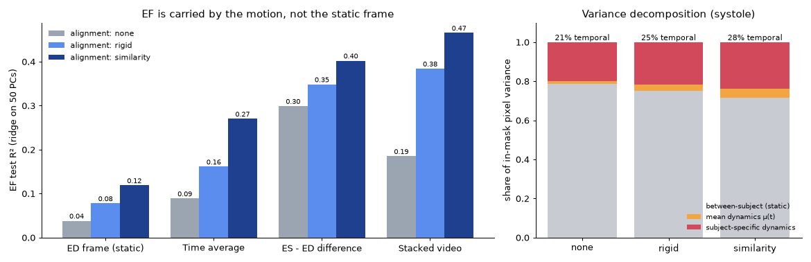

### 3.1 How much of the signal is temporal?

Shares of in-mask pixel variance on the registered systolic phase:

| Alignment | Mask px | Between-subject | Within-subject (temporal) | of which: mean dynamics μ(t) | of which: subject-specific |
|---|---:|---:|---:|---:|---:|
| none | 7,571 | 0.788 | **0.212** | 0.013 | 0.200 |
| rigid | 5,295 | 0.752 | **0.248** | 0.030 | 0.218 |
| similarity | 4,185 | 0.716 | **0.284** | 0.044 | 0.240 |

For comparison, in ADNI the leading temporal mode was constant and carried
99.0% of the temporal variance. Here 21–28% of all pixel variance is
within-subject change over the heartbeat, and most of it is subject-specific
rather than the shared mean motion. Alignment moves variance from
"between-subject" (largely misalignment) to dynamics. Dividing each video by
its normalisation scale adds about 1–3 points (`report/tables.md`).

### 3.2 Is EF carried by the motion?

EF on TEST from ridge regression on 50 PCA scores (penalty tuned on VAL; full
table for k = 10, 20, 50 in `report/tables.md`):

| Features (each is a PCA input) | none R² | rigid R² | similarity R² | similarity MAE | similarity AUC (EF < 40%) |
|---|---:|---:|---:|---:|---:|
| ED frame only (static) | 0.04 | 0.08 | 0.12 | 8.75 | 0.75 |
| Average over the frames (time discarded) | 0.09 | 0.16 | 0.27 | 8.06 | 0.83 |
| ES − ED difference image | 0.30 | 0.35 | 0.40 | 7.34 | 0.93 |
| Stacked video (11 phases, vectorised) | 0.19 | 0.38 | **0.47** | 6.95 | 0.92 |

The static ED frame predicts almost nothing (R² ≤ 0.12), so the concern that
EF is mostly heart size does not hold here. Every representation that keeps
the motion does much better. Alignment helps every row and doubles the
stacked-video R².

**What this means for the MatFPCA comparison:** with alignment, the
vectorised stacked-video PCA is a strong baseline (R² 0.47). MatFPCA should be
judged against it on EF, and above all on what dense PCA cannot do:
- work from sparse frames (3–8 per subject);
- separate the spatial and temporal structure in interpretable components;
- reconstruct held-out frames.

For reference, the published EchoNet-Dynamic deep model reports EF MAE of
about 4.1 on TEST. These unsupervised linear features are not expected to
match it.

### 3.3 Spatial maps

| No alignment | Similarity alignment |
|---|---|
|  |  |

(Rigid: `report/figures/variance_maps_rigid.png`.) After alignment the mean
frame is a sharp LV, and the mean ES − ED image shows the valve plane moving
toward the apex and the walls thickening. Temporal variation concentrates on
the septum, the lateral wall and the mitral annulus. Static between-subject
variation dominates the outer fan.

## 4. Pilot MatFPCA fit (56 × 56, n = 500)

**Setup.**
- **Data.** Similarity-aligned, gain-normalised frames, block-averaged to
  56 × 56. The mask has 1,006 pixels.
- **Subjects.** 500 TRAIN subjects (stratified by EF decile), 300 VAL
  subjects (to tune the ridge penalty) and all 1,231 TEST subjects.
- **Designs.**
  - *Sparse:* each subject keeps m_i ~ U{3,…,8} random systolic frames
    (2,779 TRAIN frames, 5.6 per subject).
  - *Dense:* all systolic frames (8,939).
- **Fit.** Settings as in ADNI: `fit_matfcov` (gaussian_refined, 3-fold
  cross-fit, noise = TRUE) → `eigen.matfcov` → `trunc.matfeigen` (95%
  temporal PVE), with full spatial ranks.
- **Run time.** Each fit takes about 1 minute; the whole job takes about 8.
- **Scores.** A vectorised version of `get_matfpca_scores` (the script checks
  it against the package function; relative difference about 1e-15).
- **Outputs.** Tables and figures are in `report/pilot/`.

### 4.1 Go/no-go checks (PLAN.md §4)

| Check | Result | |
|---|---|---|
| Dynamic temporal modes carry ≥ 10% of the temporal variance | **34.1%** with sparse frames, 38.2% with dense frames (ADNI: 0.98%) | pass |
| EF test R² from MatFPCA clearly above the static ED-frame PCA | 0.34–0.35 vs 0.08 (k = 50–100) | pass |
| Eigenimages not dominated by fan edges, ticks or artefacts | leading eigenimages sit on the septum, LV walls and valve plane | pass |


The temporal structure is clean:
- θ₁ is almost exactly constant and carries 66% of the temporal variance
  (the static between-subject part).
- θ₂–θ₆ are smooth contraction profiles that together carry 34%.
- Ranks: K = 5 (sparse fit) or 6 (dense fit), with I = J = 56.

Mean video (μ(1) − μ(0) shows the average systolic change after
alignment):

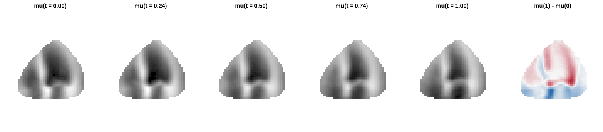

### 4.2 Sparse frames recover the dense fit

`report/pilot/sparse_vs_dense.csv` compares the fit trained on 3–8 frames
per subject with the fit trained on all frames:

| Quantity | Sparse vs dense fit |
|---|---|
| Temporal eigenfunctions 1–4, \|cos\| | 0.9998, 0.998, 0.990, 0.954 |
| Leading 10-dim row / column eigenspaces, mean principal cosine | 0.997 / 0.990 |
| Mean video, relative L2 difference | 3.1% |
| TEST scores: R² of dense-fit FPC1–50 on sparse-fit FPC1–50 (mean / min) | 0.990 / 0.855 |

With less than a third of the frames, the sparse fit recovers essentially
the same eigensystem.

### 4.3 EF prediction (TEST, n = 1,231)

Each method uses ridge regression on k features, with the penalty tuned on
VAL. Rows below are from the sparse fit. The dense fit gives the same
picture: `report/pilot/dense/ef_prediction.csv`.

| Representation | Frames used per TEST subject | R² (k = 50) | R² (k = 100) | MAE (k = 100) | AUC EF<40% (k = 100) |
|---|---|---:|---:|---:|---:|
| PCA of ED frame (static) | 1 (ED landmark) | 0.08 | 0.06 | 8.89 | 0.69 |
| PCA of average of sparse frames (time discarded) | 3–8 | 0.18 | 0.16 | 8.48 | 0.76 |
| PCA of linearly interpolated sparse video | 3–8 | 0.30 | 0.29 | 7.96 | 0.86 |
| MatFPCA product-FPC scores, top k by eigenvalue | 3–8 | 0.22 | 0.21 | 8.28 | 0.81 |
| **MatFPCA predicted video → PCA** | **3–8** | **0.34** | **0.35** | **7.57** | **0.89** |
| *PCA of ES − ED difference image* | *2 (landmarks)* | *0.33* | *0.28* | *7.96* | *0.89* |
| *PCA of dense stacked video* | *all (≈ 17)* | *0.37* | *0.39* | *7.33* | *0.90* |
| *MatFPCA predicted video → PCA* | *all* | *0.37* | *0.39* | *7.40* | *0.90* |


How to read this table:
- **From 3–8 frames, MatFPCA is the best representation.** It beats naive
  interpolation of the same frames (0.35 vs 0.29) and closes most of the gap
  to the dense-video oracle (0.39). With all frames it matches dense PCA.
  This is the result the paper needs: the method's value lies in the sparse
  regime.
- **Do not use raw product-FPC scores ranked by eigenvalue as features.**
  Each product eigenimage φ_j ψ_kᵀ is rank-one in space, so a single
  component carries only about 0.5% of the variance. The top 50 explain only
  17%, the top 200 only 40%. The useful representation is the full score
  tensor, i.e. the predicted video, compressed afterwards.
- **The leading directions of variation are still mostly static.** The
  leading PCs of the predicted videos change little over phase
  (`report/pilot/sparse/video_pcs.png`):
  - video PC1 is LV-wall position and width (ρ with EF = −0.29);
  - video PC2 is a top-to-bottom gain gradient.

  The EF-relevant motion sits in lower-variance directions, which is why
  k ≈ 100 helps.
- **k is not tuned here.** The two k columns are reported side by side; the
  main analysis should choose k on VAL.

### 4.4 Reconstruction of held-out frames (TEST)

Each TEST video is predicted from its 3–8 sparse frames. "Held-out" means
the frames that were not given to the model (`reconstruction_summary.csv`;
intensities are gain-normalised, so the mean in-mask intensity is 1):

| Method | RMSE (held-out frames) | Correlation | Motion correlation* |
|---|---:|---:|---:|
| Mean video μ(t) only | 0.841 | 0.59 | 0.41 |
| Mean + static PCA (20 PCs of time-averaged images) | 0.591 | 0.82 | 0.41 |
| **MatFPCA** | **0.310** | **0.95** | **0.82** |

\*Correlation between the predicted and observed within-video motion (each
frame minus its video's average).

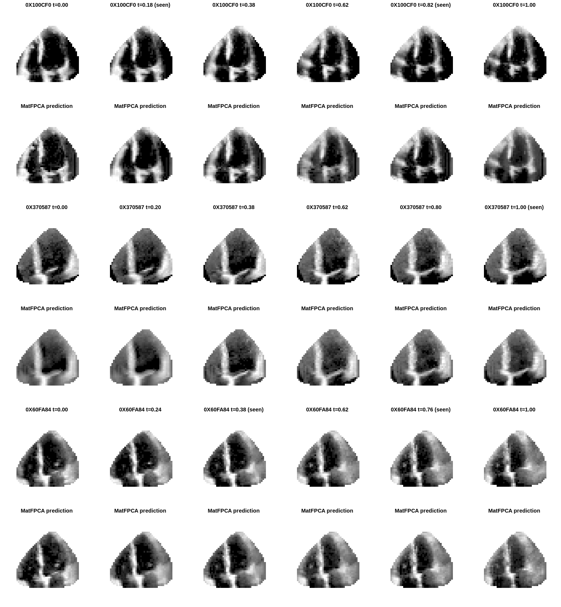

Top row of each pair: observed frames ("seen" marks the frames given to the
model). Bottom row: the MatFPCA prediction.

## 5. Main MatFPCA fit (112 × 112, n = 500)

**Setup.** As in the pilot, with these changes:
- **Resolution.** Full resolution, 112 × 112. The mask has 4,185 pixels.
- **Subjects.** 500 stratified TRAIN subjects (§5.1), 500 VAL subjects and
  all 1,231 TEST subjects.
- **Choice of k.** The number of components k is now chosen on VAL, together
  with the ridge penalty, from {10, 20, 50, 100, 200, 499}.
- **Targets.** ESV and EDV are added to EF.
- **Interpretation outputs.** New figures show what each mode means (§5.5).
- **Run time.** The sparse fit took 15 min and the dense fit 4 min, on 16
  CPUs. The peak memory was about 13 GB.

Outputs are in `report/main/`.

### 5.1 Are 500 TRAIN subjects representative?

The 500 subjects are not a simple random sample. They are a **stratified**
sample:
1. Each TRAIN video is described by its EF and by its *appearance*, i.e. the
   PCA scores of its time-averaged image and its ES − ED image.
2. Videos are grouped into 8 appearance clusters by k-means.
3. Crossing EF quintile with appearance cluster gives 40 strata (cells), and
   each stratum gets its proportional share of the 500.

So no kind of heart (by EF) and no kind of image (by appearance) can be left
out by chance. The ranking is systematic within strata, so the first 250,
1,000 or 2,000 are also stratified samples, and ranks 501–1,000 form a
second, disjoint sample of 500. §5.2 uses both.

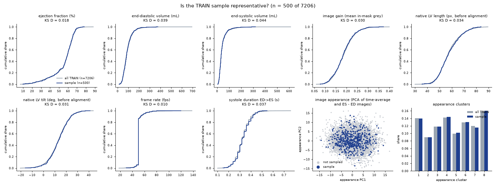

`report/main/sample_check.csv`, `sample_strata.csv`:

| Variable | All 7,206 TRAIN: median | Sample of 500: median | KS D (5% critical value 0.063) |
|---|---:|---:|---:|
| EF (%) | 59.3 | 59.3 | 0.018 |
| EDV (mL) | 81.7 | 83.9 | 0.039 |
| ESV (mL) | 33.4 | 33.7 | 0.044 |
| image gain | 0.185 | 0.183 | 0.030 |
| native LV length (px) | 56.4 | 56.9 | 0.034 |
| native LV tilt (°) | 13.4 | 13.9 | 0.031 |
| frame rate (fps) | 50 | 50 | 0.010 |
| systole duration (s) | 0.32 | 0.32 | 0.037 |

Rare groups, expected vs sampled: EF < 30%: 30.7 vs 28; EF < 40%: 63.4 vs
60; EF ≥ 75%: 3.3 vs 3. All 40 strata are represented, and none is more
than one subject away from its proportional count. No variable differs
significantly from the full TRAIN set.

### 5.2 Is n = 500 enough? (sample-size study, 56 × 56)

**Question:** does the MatFPCA fit need more than 500 subjects? We fit the
sparse-design model at 56 × 56 on nested stratified TRAIN samples of 250,
500, 1,000 and 2,000, and on a second, **disjoint** sample of 500 (ranks
501–1,000, "500b"). Each fit is compared with the n = 2,000 fit.

To separate the MatFPCA estimate from the EF regression, the mean and
covariance are fitted on n subjects, but the subjects are then scored with
that model, and the EF ridge regression is always trained on the same 2,000
TRAIN subjects. So only the MatFPCA estimate changes between rows
(`report/sample_size/sample_size.csv`):

| MatFPCA fitted on | Fit time* | K | Dynamic share | θ₂ / θ₃ \|cos\| vs n=2,000 | Row / column 10-dim subspace cos | Mean video diff | **EF TEST R²** (MatFPCA video, sparse frames) | Held-out RMSE |
|---|---:|---:|---:|---:|---:|---:|---:|---:|
| 250 | 45 s | 4 | 30.7% | 0.995 / 0.983 | 0.89 / 0.92 | 5.2% | **0.426** | 0.391 |
| 500 | 3–6 min | 5 | 34.7% | 0.998 / 0.995 | 0.84 / 0.85 | 3.4% | **0.425** | 0.310 |
| 500b (disjoint) | 3–4 min | 4 | 30.8% | 0.996 / 0.964 | 0.87 / 0.89 | 3.5% | **0.428** | 0.362 |
| 1,000 | 11 min | 4 | 29.5% | 0.999 / 0.967 | 0.94 / 0.95 | 2.0% | **0.432** | 0.344 |
| 2,000 | 39 min | 4 | 29.8% | 1 / 1 | 1 / 1 | 0 | **0.427** | 0.323 |

\*Fit time is on 16 CPUs and is approximate, because the jobs shared nodes.
For reference, with the same 2,000 regression subjects, PCA of the
interpolated sparse video gives 0.389 and the dense-video PCA gives 0.501.

**Answer: 500 is enough, and even 250 is.**
- **EF.** Downstream EF accuracy is flat in n (0.425–0.432). Fitting on
  250 subjects gives the same EF as fitting on 2,000, at a fiftieth of the
  cost.
- **Temporal eigenfunctions.** The dynamic modes θ₂ and θ₃ are already
  stable at n = 250 (|cos| ≥ 0.96).
- **Mean video.** It converges smoothly (5% → 2%).
- **Spatial subspaces.** Agreement is 0.84–0.95 rather than about 1.
  Because the spatial spectrum is flat (§5.5), the boundary of any
  "leading 10" subspace falls among near-equal eigenvalues, so this measure
  is pessimistic. The downstream results do not depend on it.
- **Two disjoint samples of 500.** They give the same EF (0.425 vs 0.428).
  The held-out RMSE differs (0.31 vs 0.36) mainly because the 95%-PVE rule
  kept K = 5 temporal modes in one fit and K = 4 in the other. The RMSE
  follows the number of temporal modes kept more than it follows n.

`sample_size_regression_also_n.csv` gives the version in which the EF
regression is *also* trained on only n subjects. There every method,
including the plain PCA baselines, improves with n (MatFPCA 0.33 → 0.43,
dense PCA 0.39 → 0.50). That gain comes from having more labelled examples
for the regression, not from a better MatFPCA estimate. MatFPCA stays
0.02–0.05 above interpolation at every n.

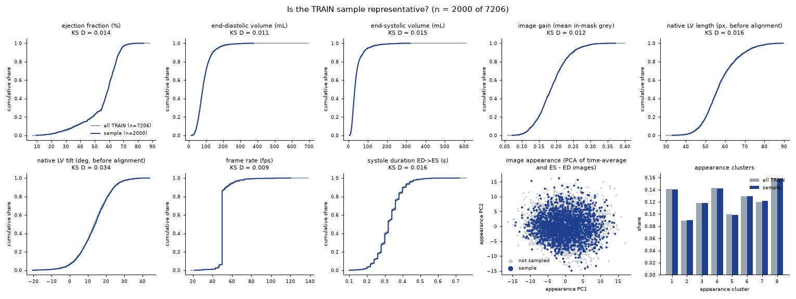

### 5.3 Temporal structure and sparse vs dense

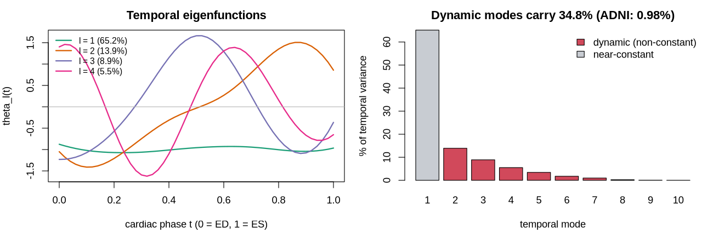

| | Sparse fit (3–8 frames) | Dense fit (all frames) |
|---|---:|---:|
| ranks I × J × K | 112 × 112 × 5 | 112 × 112 × 9 |
| θ₁ (constant) share of temporal variance | 65% | 55% |
| dynamic share (go if ≥ 10%) | **34.8%** | 43.4% |
| noise variance σ² | 0.0102 | 0.0023 |

**What the temporal modes mean** (sparse fit):
- **θ₁ (65%)** is flat. It carries how a heart looks regardless of phase:
  anatomy, image quality, and what remains of the alignment differences.
- **θ₂ (14%)** rises steadily from ED to ES. It is the **amount of
  contraction**: a subject with a positive θ₂ score changes more than
  average between ED and ES, and one with a negative score changes less.
- **θ₃ (9%)** is a single bump that peaks at mid-systole (t ≈ 0.5). It
  captures **how the change is spread over the phase**: early and strong
  vs late and weak motion in the middle of contraction.
- **θ₄ (6%)** dips near t ≈ 0.3 and peaks near t ≈ 0.65. It is a **timing
  shift**: contraction that runs early or late relative to the
  ED-to-ES clock.

**Sparse vs dense at full resolution.** The agreement is weaker than at
56 × 56 (`report/main/sparse_vs_dense.csv`):

| Quantity | Value |
|---|---|
| θ₁–θ₄ \|cos\| | 0.997, 0.984, 0.937, 0.818 |
| 10-dim row / column subspaces, mean principal cosine | 0.89 / 0.89 |
| Mean video, relative difference | 2.8% |
| TEST scores, R² of dense FPC1–50 on sparse FPC1–50 | 0.87 mean (0.57 min) |

The sparse fit puts more into noise (σ² 0.010 vs 0.0023) and less into the
fast temporal modes. At full resolution there is fine-scale speckle that
changes from frame to frame. With 3–8 frames per subject, that rapid change
cannot be told apart from noise, so the sparse fit treats it as noise. This
is the expected behaviour, and it does not hurt the sparse fit's job: scored
on the sparse TEST frames, the **sparse-trained** model is better for EF
(R² 0.39) than the dense-trained one (0.35).

### 5.4 Prediction from the videos (TEST, n = 1,231; k chosen on VAL)

`report/main/sparse/prediction_selected_k.csv`:

| Representation | Frames per TEST subject | k | EF R² | EF MAE | AUC EF<40% | ESV R² | EDV R² |
|---|---|---:|---:|---:|---:|---:|---:|
| PCA of ED frame (static) | 1 | 100 | 0.08 | 8.75 | 0.72 | 0.09 | 0.10 |
| PCA of average of sparse frames | 3–8 | 50 | 0.20 | 8.32 | 0.79 | 0.20 | 0.18 |
| PCA of linearly interpolated sparse video | 3–8 | 100 | 0.33 | 7.66 | 0.88 | 0.27 | 0.20 |
| MatFPCA product-FPC scores, top k | 3–8 | 200 | 0.34 | 7.70 | 0.88 | 0.22 | 0.17 |
| MatFPCA static part only (θ₁) → PCA | 3–8 | 50 | 0.22 | 8.28 | 0.81 | 0.21 | 0.17 |
| MatFPCA dynamic part only (θ₂₊) → PCA | 3–8 | 100 | 0.25 | 8.22 | 0.87 | 0.11 | 0.05 |
| **MatFPCA predicted video → PCA** | **3–8** | 100 | **0.39** | **7.35** | **0.90** | **0.29** | **0.22** |
| *PCA of ES − ED difference image* | *2 (landmarks)* | 50 | *0.31* | *7.89* | *0.90* | *0.15* | *0.08* |
| *PCA of dense stacked video* | *all (≈ 17)* | 200 | *0.44* | *7.05* | *0.92* | *0.33* | *0.24* |
| *MatFPCA predicted video → PCA (all frames)* | *all* | 200 | *0.42* | *7.14* | *0.91* | *0.32* | *0.23* |

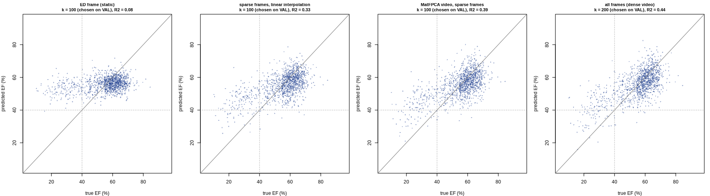

How to read this table:
- **From 3–8 frames, MatFPCA is again the best representation.** It beats
  interpolating the same frames on every target (EF R² 0.39 vs 0.33; ESV
  0.29 vs 0.27; EDV 0.22 vs 0.20). It recovers most of what the full video
  gives (0.44). Going to full resolution improved most methods by
  0.02–0.05 over the pilot.
- **The split into static and dynamic parts is informative.** Neither part
  alone is enough for EF (0.22 and 0.25); together they give 0.39.
  - The **dynamic** part alone ranks reduced-EF hearts almost as well as the
    full model (AUC 0.87 vs 0.90), but it carries almost nothing about
    volume (EDV R² 0.05).
  - The **static** part carries the volume information (EDV 0.17).
  - This matches the clinical definition: EF is about how much the LV
    moves, and volume is about how big it is.
- **Volumes are hard by design.** Similarity alignment rescales every LV to
  the same length, so absolute size is mostly removed. ESV and EDV R² stay
  below 0.35 for every method. The `rigid` alignment, which keeps size, is
  the natural choice if volumes become a target.

### 5.5 What each mode shows

PCA-type components do not always have a clean meaning. Here we read them
in three complementary ways.

**(a) Spatial eigenvectors** (`report/main/sparse/spatial_modes.png`).

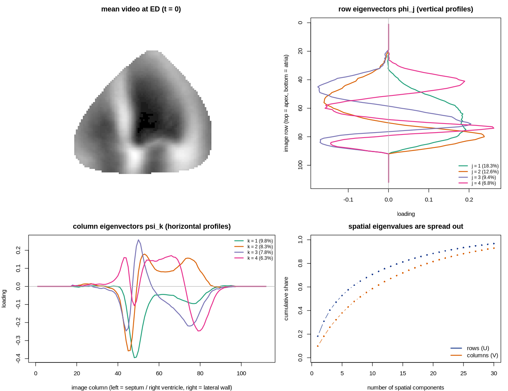

- **Column eigenvectors ψ_k (left to right):**
  - ψ₁ is a sharp peak on the **septum**.
  - ψ₂ has two peaks, on the septum and on the **lateral wall**.
  - ψ₃ contrasts the septum (+) with the lateral wall (−).
  - ψ₄ covers the LV cavity and the lateral wall.
- **Row eigenvectors φ_j (top to bottom):**
  - φ₁ is a broad bump over the middle of the ventricles down to the valve
    plane.
  - φ₂ contrasts the upper (apical) half with the **valve plane** and atria.
  - φ₃ and φ₄ separate the apex, the mid-ventricle and the valve plane.

So each product eigenimage φ_j ψ_kᵀ is a small patch on a named structure.
The spatial spectrum is spread out: about 20 row and 30 column components
are needed for 90%. This is why any single product FPC is tiny, and why the
eigen-videos below, which combine many of them, are easier to read.

**(b) Principal eigen-videos** (`eigen_videos_all.png`,
`eigen_videos_dynamic.png`, `eigen_video_interpretation.csv`). Each
eigen-video is shown as the mean video − / + 2 SD at ED and at ES. It is
correlated (Spearman ρ, all 2,231 subjects) with the clinical labels and
with acquisition variables:
- *gain*: image brightness;
- *LV length*: native heart size or zoom, before alignment;
- *LV tilt*;
- *fps*;
- *systole duration*.

The +2 SD side is always the higher-EF side.

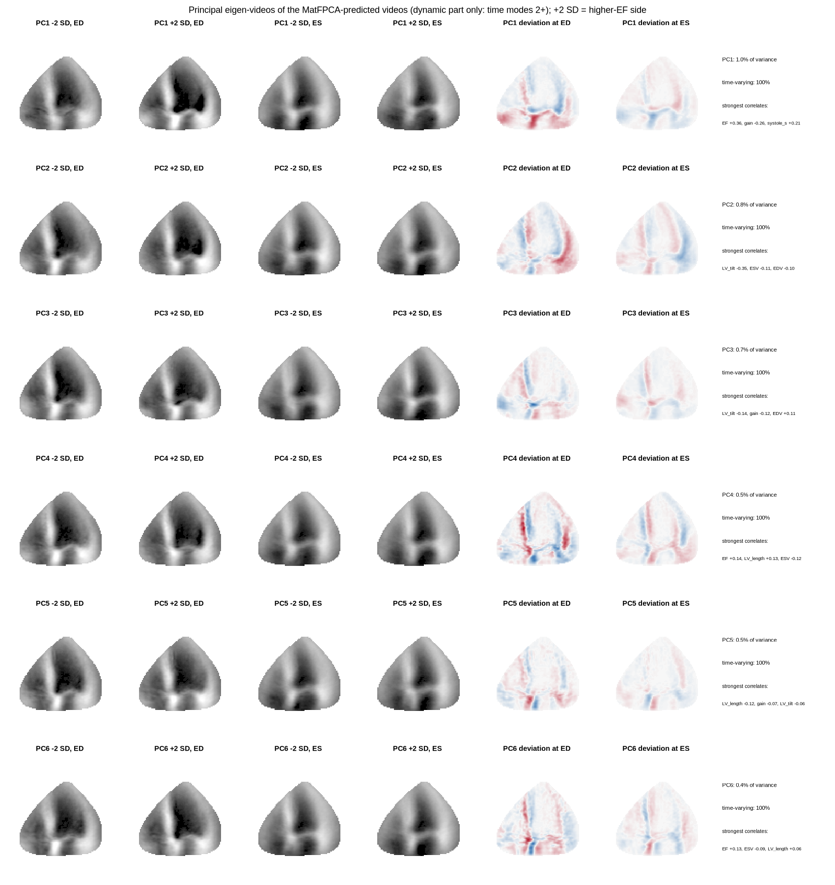

| Eigen-video | % of video variance | Changes over phase | Strongest correlates | Reading |
|---|---:|---:|---|---|
| all-parts PC1 | 9.5% | 4% | EF +0.26, gain −0.20, LV length +0.17 | **wall contrast / image quality**: sharp bright septum and walls vs a washed-out image |
| all-parts PC2 | 6.5% | 4% | LV length +0.25 | **septum–lateral wall spacing** (LV width after the size rescaling) |
| all-parts PC3 | 6.0% | 4% | LV length −0.22, tilt −0.20, EDV −0.17 | **how the fan is filled** (dark band at the right sector edge): zoom and angle of acquisition |
| all-parts PC4 | 4.9% | 6% | gain +0.35 | **left–right brightness balance** (RV side): acquisition |
| all-parts PC5 | 4.5% | 9% | tilt +0.41 | **residual rotation** of the septum |
| **dynamic PC1** | 1.0% | 100% | **EF +0.36**, gain −0.26, systole duration +0.21 | **contraction strength**: at +2 SD the LV is wide at ED and closes at ES, and the valve plane moves up; at −2 SD ED and ES look alike |
| dynamic PC2 | 0.8% | 100% | tilt −0.35 | wall motion that differs between the septum and the lateral wall; follows the residual tilt (less clear) |
| dynamic PC4 | 0.5% | 100% | EF +0.14, ESV −0.12 | inward motion of both walls, on top of dynamic PC1 |

The leading **all-parts** eigen-videos are almost static (4–9% of each
changes over phase) and are dominated by image acquisition: contrast, gain,
zoom and angle. That is expected, because they are the largest sources of
pixel variance. The leading **dynamic** eigen-video is the one a
cardiologist would recognise: how strongly the heart contracts. It is the
single component most correlated with EF.

**(c) What distinguishes reduced-EF hearts?** (`ef_groups.png`). These are
group means of the TEST videos: reduced EF (< 40%, n = 157) vs normal EF
(≥ 55%, n = 844).
- Top row: observed from all frames.
- Bottom row: MatFPCA predicted from 3–8 frames per heart.

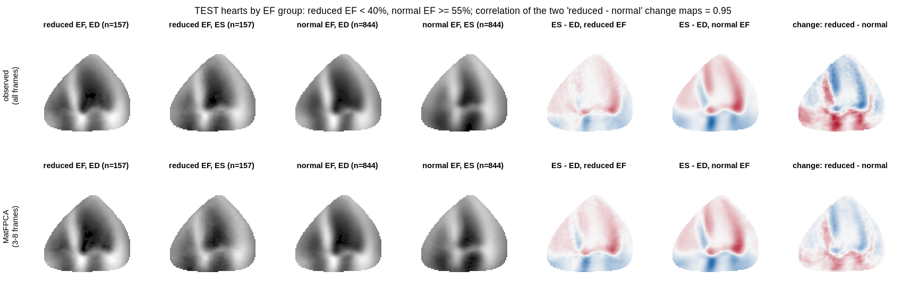

In the "ES − ED" maps, red marks pixels that get brighter during
contraction (tissue moving in) and blue marks pixels that get darker:
- **Normal hearts:** strong red along the septum and the lateral wall (the
  walls thicken and move inwards), and blue at the base (the valve plane
  moves up and the dark atria fill the space).
- **Reduced-EF hearts:** a much weaker version of the same pattern.

The "reduced − normal" map is therefore the normal pattern with the sign
flipped. The map predicted from 3–8 frames correlates **0.95** with the
map from all frames.

### 5.6 Reconstruction of held-out frames (TEST)

| Method | RMSE (held-out frames) | Correlation | Motion correlation |
|---|---:|---:|---:|
| Mean video μ(t) only | 0.884 | 0.57 | 0.38 |
| Mean + static PCA (20) | 0.645 | 0.79 | 0.38 |
| **MatFPCA** | **0.391** | **0.93** | **0.75** |

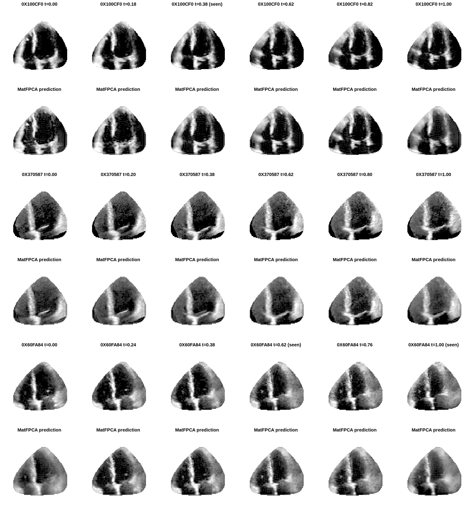

The RMSE is higher than in the pilot (0.31), most likely because full
resolution keeps the frame-to-frame speckle that the 2 × 2 averaging
smoothed out. That speckle cannot be predicted from other frames.

### 5.7 Computing cost: where the time goes

Profiling `fit_matfcov` shows that more than 90% of the time is spent in
`mgcv::gam`, fitting the bivariate tensor spline for the temporal
covariance K.
- **Why it grows with n.** With `nbasis = "theory"`, the marginal basis size
  is J ≈ 3 (n_eff · r_space)^{1/6}, where r_space grows with p·q. The
  smoother has J² coefficients and is refitted for every cross-fit fold.
- **Measured.** Doubling n from 125 to 250 at 56 × 56 multiplied the fit
  time by 6.5 (10 s → 67 s). The 112 × 112 fit (15 min) is slower than the
  56 × 56 fit (1 min) for the same reason.
- **Why dense is faster.** Dense designs have more than 10⁵ pairs, which
  switches the code to `mgcv::bam`. That is why the dense fit takes 4 min.

**A cheap fix if larger n is needed.** The phases lie on the 51-point grid,
so all pair pseudo-observations fall in at most 51 × 51 cells. Averaging
them within cells, and passing the counts as weights, gives the same
penalised least-squares fit for a given smoothing parameter. The smoother
would then cost the same for any n. Only the REML scale estimate needs the
within-cell sum of squares added back. A smaller step is to use
`bam(..., discrete = TRUE)` for all designs. Neither is implemented yet; at
n = 500 neither is needed.

## 6. Decisions so far, and what is next

- **Defaults:**
  - `similarity` alignment and gain normalisation;
  - gaussian_refined weights;
  - sparse design with m_i ~ U{3,…,8};
  - **n = 500 stratified TRAIN subjects at 112 × 112** (§5.1–5.2).
- **EF features:** PCA of the MatFPCA-predicted videos, with k chosen on
  VAL. Product-FPC scores and the static / dynamic split are reported
  alongside.
- **Kept as sensitivity analyses:** `rigid` alignment (keeps LV size, for
  ESV/EDV) and `none`.
- **Next:**
  1. Principal curve through the dynamic scores, coloured by EF.
  2. A short animated version of `ef_groups.png` and dynamic PC1 (GIF or
     strip over 11 phases).
  3. Optionally, the `rigid` and `none` variants.
  4. Optionally, binned smoothing in `fit_matfcov` (§5.7) if larger n is
     wanted.

## 7. How to reproduce

```bash
# one-off environment (Compute Canada wheels)
module load python/3.11
python -m venv application/echonet/.venv
source application/echonet/.venv/bin/activate
pip install --no-index -r application/echonet/requirements.txt

# preprocessing (3 alignment modes, ~2 min each on 32 CPUs) + Phase-0 report
mkdir -p application/echonet/output
sbatch application/echonet/run_prepare.sbatch

# RDS conversion + pilot fits + sparse/dense comparison (~10 min, 8 CPUs)
sbatch application/echonet/run_pilot.sbatch

# main fits at 112 x 112, n = 500 (~25 min, 16 CPUs, 96 GB requested)
sbatch application/echonet/run_main.sbatch

# sample-size study at 56 x 56, n = 250 ... 2,000
sbatch application/echonet/run_sample_size.sbatch

# dataset figure (login node is fine, a few seconds)
python application/echonet/figure_dataset.py
```

Data are expected in `data/EchoNet-Dynamic/` (`Videos/`, `FileList.csv`,
`VolumeTracings.csv`).

| Output (in `output/prep_<mode>/`, not tracked) | Content |
|---|---|
| `frames/<id>.npz` | uint8 registered systolic frames, `frame_idx`, `phase`, `grid_idx`, `fan` |
| `videos.csv` | one row per video: labels, landmarks, QC, exclusion reason, `norm_scale` |
| `manifest.csv` | one row per systolic frame of retained videos (`retained` = kept after grid snapping) |
| `mask.npy`, `mask_coverage.npy`, `mask.png` | analysis mask |
| `qc_summary.csv`, `config.json` | exclusion counts, run settings, canonical long axis |

| Pilot outputs (in `output/`, not tracked) | Content |
|---|---|
| `export_pilot56/` | `frames.f32` + `frames.csv`, `subjects.csv`, `mask.csv` (Python export); `rds/<id>.rds` per-subject `rTensor` (p × q × m_i) and `frames_rds.csv` with `t_idx` (R conversion) |
| `pilot56_{sparse,dense}/` | `model.rds` (covariance, eigensystem, mean), `scores.csv` (top product-FPC scores, both designs, all splits), tables, figures |

| Main / sample-size outputs (in `output/`, not tracked) | Content |
|---|---|
| `export_main112/`, `export_n56/` | exports as above; `subjects.csv` also has `train_rank`, `appearance_cluster`, `ef_quintile`; `sample_check.csv`, `sample_strata.csv`, `sample_representativeness.png` |
| `main112_{sparse,dense}/` | as the pilot, plus `prediction_all_k.csv` (EF/ESV/EDV, every k), `prediction_selected_k.csv` (k chosen on VAL), `eigen_video_interpretation.csv` |
| `nstudy_n{250,500,500b,1000,2000}/` | sparse fits on nested stratified TRAIN samples (n500b = ranks 501–1,000) |

Tracked results: `report/` (Phase 0), `report/pilot/` (pilot fits),
`report/main/` (main fits) and `report/sample_size/` (sample-size study).

Note: since the main fits, each subject's sparse frames are drawn with a
per-subject seed, so the sparse subsets differ from those used in the pilot
(`report/pilot/` was produced with the earlier draw).
