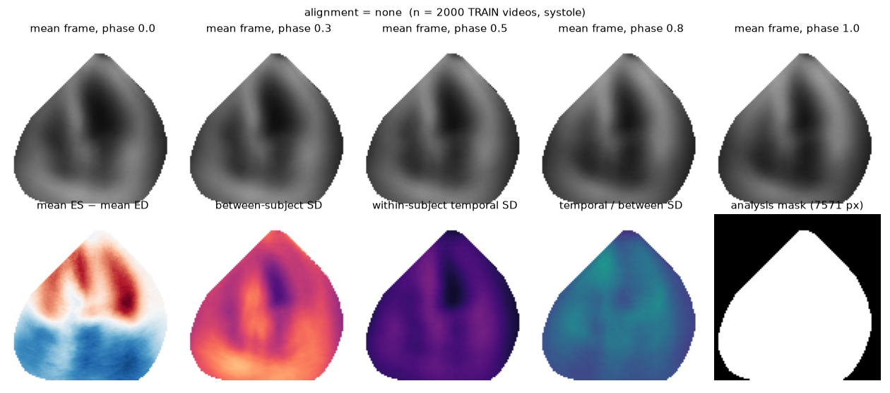
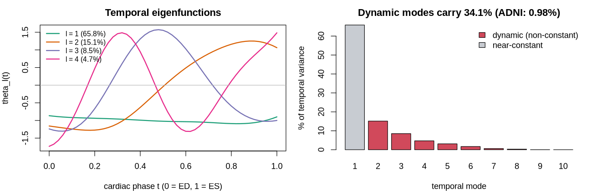
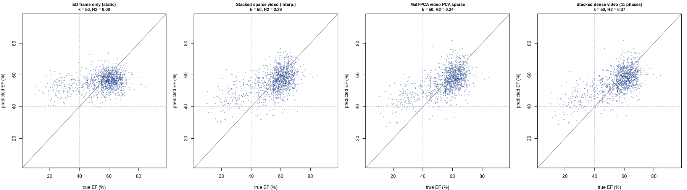

# EchoNet-Dynamic: MatFPCA of cardiac ultrasound videos

The design is in `PLAN.md`. This file records **what has been run and what
came out**. It is updated after each stage.

| Stage | Status | Date |
|---|---|---|
| Metadata check, Phase-0 go/no-go | done: **go** | 2026-11-23 |
| Preprocessing (`prepare_echonet.py`), three alignment modes | done | 2026-11-23 |
| Conversion to per-subject `rTensor` RDS (`export_echonet.py` → `echonet_to_rds.R`) | done | 2026-11-23 |
| Pilot MatFPCA fits (56 × 56, n = 500, sparse and dense) | done: **go** on all three checks | 2026-11-23 |
| Main fits (112 × 112, n = 2,000), full EF analysis | not started | |

## 1. The data in one figure


Each video is an apical four-chamber echocardiogram (112 × 112 pixels, usually
50 fps, several heartbeats). Experts traced the left ventricle (LV) on two
frames: **end-diastole (ED)**, when the LV is fullest, and **end-systole (ES)**,
when it is most contracted. Ejection fraction is EF = (EDV − ESV) / EDV.

Bottom row: the mean grey level inside the ED outline over the whole clip.
Blood is dark and muscle is bright, so the curve rises as the LV empties. The
expert ED and ES frames sit at the curve's minimum and peak. We keep the
systolic window (shaded) and map it to **cardiac phase t ∈ [0, 1]**
(ED → 0, ES → 1). Heart and frame rates differ between patients, so each
patient's frames fall on their own irregular set of phases.

## 2. Preprocessing

`prepare_echonet.py` (Python, PyAV) does the following for each video:

1. **Landmarks.** ED and ES come from `VolumeTracings.csv`. ED is the traced
   frame with the larger area. The ED long axis gives the apex and base points.
2. **Grey scale.** Grey is the mean of R, G and B.
3. **Overlay removal.** The fan is taken as the convex hull of the largest
   bright component of the clip's maximum projection. Everything outside it is
   set to 0. This removes the depth-scale ticks and the apex marker, which
   were the only colour pixels in ordinary videos.
4. **LV alignment** (optional, `--align`): one transform per video from the
   ED long axis. A single transform per video keeps the wall motion.
   - `none`: no transform.
   - `rigid`: rotate and translate the LV onto the canonical (median TRAIN)
     long axis; LV size is kept.
   - `similarity`: also scale the LV to the canonical length; size is removed.
     EF is a ratio, so it does not depend on size.
5. **Phase registration.** Keep frames ED…ES, set t = (frame − ED)/(ES − ED),
   and snap t to a 51-point grid (step 0.02).
6. **Analysis mask.** Keep pixels that lie inside the (aligned) fan in at
   least 90% of retained TRAIN videos.
7. **Normalisation scale.** For each video, record the mean in-mask grey
   level over its retained frames. The scale is stored but not applied.

**Why alignment is needed.** The ED tracings show that patients' hearts sit
in different places, and the differences are larger than the wall motion we
want to model (LV walls move about 5–8 px):

| ED long axis (5% / 50% / 95%) | Value |
|---|---|
| Length (px) | 44.9 / 56.4 / 74.4 |
| Tilt from vertical (°) | −1.5 / 13.4 / 27.3 |
| LV-centre spread (px), 5%–95% range | ~15 horizontal, ~24 vertical |

**Exclusions** (`report/qc_summary.csv`; identical for all alignment modes):

| Reason | Videos | TRAIN | VAL | TEST |
|---|---:|---:|---:|---:|
| **retained** | **9,672** | 7,206 | 1,235 | 1,231 |
| colour-map display (blue tint; in-fan colour > 5%) | 142 | 104 | 20 | 18 |
| ES traced before ED | 98 | 73 | 13 | 12 |
| implausible ED long axis (robust z > 4 on length or tilt) | 92 | 66 | 15 | 11 |
| ED→ES gap > 0.80 s | 15 | 10 | 2 | 3 |
| frame size not 112 × 112 | 6 | 5 | 0 | 1 |
| ED→ES gap < 0.10 s | 5 | 1 | 3 | 1 |

The retained videos have 6–48 systolic frames (median 17; 5%–95%: 12–24).
12.5% of them have EF < 40%. **No colour Doppler** was found: the coloured
videos use a blue display colour map over the whole image.

## 3. Phase-0 results (go/no-go)

`explore_echonet.py` uses 2,000 retained TRAIN videos, all VAL videos (for the
ridge penalty) and all TEST videos. These checks do **not** use MatFPCA yet:
for speed, frames are interpolated onto 11 phases, and the models are plain
PCA with ridge regression.


### 3.1 How much of the signal is temporal?

Shares of in-mask pixel variance on the registered systolic phase:

| Alignment | Mask px | Between-subject | Within-subject (temporal) | of which: mean dynamics μ(t) | of which: subject-specific |
|---|---:|---:|---:|---:|---:|
| none | 7,571 | 0.788 | **0.212** | 0.013 | 0.200 |
| rigid | 5,295 | 0.752 | **0.248** | 0.030 | 0.218 |
| similarity | 4,185 | 0.716 | **0.284** | 0.044 | 0.240 |

For comparison, in ADNI the leading temporal mode was constant and carried
99.0% of the temporal variance. Here 21–28% of all pixel variance is
within-subject change over the heartbeat, and most of it is subject-specific
rather than the shared mean motion. Alignment moves variance from
"between-subject" (largely misalignment) to dynamics. Dividing each video by
its normalisation scale adds about 1–3 points (`report/tables.md`).

### 3.2 Is EF carried by the motion?

EF on TEST from ridge regression on 50 PCA scores (penalty tuned on VAL; full
table for k = 10, 20, 50 in `report/tables.md`):

| Features (each is a PCA input) | none R² | rigid R² | similarity R² | similarity MAE | similarity AUC (EF < 40%) |
|---|---:|---:|---:|---:|---:|
| ED frame only (static) | 0.04 | 0.08 | 0.12 | 8.75 | 0.75 |
| Average over the frames (time discarded) | 0.09 | 0.16 | 0.27 | 8.06 | 0.83 |
| ES − ED difference image | 0.30 | 0.35 | 0.40 | 7.34 | 0.93 |
| Stacked video (11 phases, vectorised) | 0.19 | 0.38 | **0.47** | 6.95 | 0.92 |

The static ED frame predicts almost nothing (R² ≤ 0.12), so the concern that
EF is mostly heart size does not hold here. Every representation that keeps
the motion does much better. Alignment helps every row and doubles the
stacked-video R².

**What this means for the MatFPCA comparison:** with alignment, the
vectorised stacked-video PCA is a strong baseline (R² 0.47). MatFPCA should be
judged against it on EF, and above all on what dense PCA cannot do:
- work from sparse frames (3–8 per subject);
- separate the spatial and temporal structure in interpretable components;
- reconstruct held-out frames.

For reference, the published EchoNet-Dynamic deep model reports EF MAE of
about 4.1 on TEST. These unsupervised linear features are not expected to
match it.

### 3.3 Spatial maps

| No alignment | Similarity alignment |
|---|---|
|  |  |

(Rigid: `report/figures/variance_maps_rigid.png`.) After alignment the mean
frame is a sharp LV, and the mean ES − ED image shows the valve plane moving
toward the apex and the walls thickening. Temporal variation concentrates on
the septum, the lateral wall and the mitral annulus. Static between-subject
variation dominates the outer fan.

## 4. Pilot MatFPCA fit (56 × 56, n = 500)

**Setup.**
- **Data.** Similarity-aligned, gain-normalised frames, block-averaged to
  56 × 56. The mask has 1,006 pixels.
- **Subjects.** 500 TRAIN subjects (stratified by EF decile), 300 VAL
  subjects (to tune the ridge penalty) and all 1,231 TEST subjects.
- **Designs.**
  - *Sparse:* each subject keeps m_i ~ U{3,…,8} random systolic frames
    (2,779 TRAIN frames, 5.6 per subject).
  - *Dense:* all systolic frames (8,939).
- **Fit.** Settings as in ADNI: `fit_matfcov` (gaussian_refined, 3-fold
  cross-fit, noise = TRUE) → `eigen.matfcov` → `trunc.matfeigen` (95%
  temporal PVE), with full spatial ranks.
- **Run time.** Each fit takes about 1 minute; the whole job takes about 8.
- **Scores.** A vectorised version of `get_matfpca_scores` (the script checks
  it against the package function; relative difference about 1e-15).
- **Outputs.** Tables and figures are in `report/pilot/`.

### 4.1 Go/no-go checks (PLAN.md §4)

| Check | Result | |
|---|---|---|
| Dynamic temporal modes carry ≥ 10% of the temporal variance | **34.1%** with sparse frames, 38.2% with dense frames (ADNI: 0.98%) | pass |
| EF test R² from MatFPCA clearly above the static ED-frame PCA | 0.34–0.35 vs 0.08 (k = 50–100) | pass |
| Eigenimages not dominated by fan edges, ticks or artefacts | leading eigenimages sit on the septum, LV walls and valve plane | pass |



The temporal structure is clean:
- θ₁ is almost exactly constant and carries 66% of the temporal variance
  (the static between-subject part).
- θ₂–θ₆ are smooth contraction profiles that together carry 34%.
- Ranks: K = 5 (sparse fit) or 6 (dense fit), with I = J = 56.

Mean video (μ(1) − μ(0) shows the average systolic change after
alignment):


### 4.2 Sparse frames recover the dense fit

`report/pilot/sparse_vs_dense.csv` compares the fit trained on 3–8 frames
per subject with the fit trained on all frames:

| Quantity | Sparse vs dense fit |
|---|---|
| Temporal eigenfunctions 1–4, \|cos\| | 0.9998, 0.998, 0.990, 0.954 |
| Leading 10-dim row / column eigenspaces, mean principal cosine | 0.997 / 0.990 |
| Mean video, relative L2 difference | 3.1% |
| TEST scores: R² of dense-fit FPC1–50 on sparse-fit FPC1–50 (mean / min) | 0.990 / 0.855 |

With less than a third of the frames, the sparse fit recovers essentially
the same eigensystem.

### 4.3 EF prediction (TEST, n = 1,231)

Each method uses ridge regression on k features, with the penalty tuned on
VAL. Rows below are from the sparse fit. The dense fit gives the same
picture: `report/pilot/dense/ef_prediction.csv`.

| Representation | Frames used per TEST subject | R² (k = 50) | R² (k = 100) | MAE (k = 100) | AUC EF<40% (k = 100) |
|---|---|---:|---:|---:|---:|
| PCA of ED frame (static) | 1 (ED landmark) | 0.08 | 0.06 | 8.89 | 0.69 |
| PCA of average of sparse frames (time discarded) | 3–8 | 0.18 | 0.16 | 8.48 | 0.76 |
| PCA of linearly interpolated sparse video | 3–8 | 0.30 | 0.29 | 7.96 | 0.86 |
| MatFPCA product-FPC scores, top k by eigenvalue | 3–8 | 0.22 | 0.21 | 8.28 | 0.81 |
| **MatFPCA predicted video → PCA** | **3–8** | **0.34** | **0.35** | **7.57** | **0.89** |
| *PCA of ES − ED difference image* | *2 (landmarks)* | *0.33* | *0.28* | *7.96* | *0.89* |
| *PCA of dense stacked video* | *all (≈ 17)* | *0.37* | *0.39* | *7.33* | *0.90* |
| *MatFPCA predicted video → PCA* | *all* | *0.37* | *0.39* | *7.40* | *0.90* |



How to read this table:
- **From 3–8 frames, MatFPCA is the best representation.** It beats naive
  interpolation of the same frames (0.35 vs 0.29) and closes most of the gap
  to the dense-video oracle (0.39). With all frames it matches dense PCA.
  This is the result the paper needs: the method's value lies in the sparse
  regime.
- **Do not use raw product-FPC scores ranked by eigenvalue as features.**
  Each product eigenimage φ_j ψ_kᵀ is rank-one in space, so a single
  component carries only about 0.5% of the variance. The top 50 explain only
  17%, the top 200 only 40%. The useful representation is the full score
  tensor, i.e. the predicted video, compressed afterwards.
- **The leading directions of variation are still mostly static.** The
  leading PCs of the predicted videos change little over phase
  (`report/pilot/sparse/video_pcs.png`):
  - video PC1 is LV-wall position and width (ρ with EF = −0.29);
  - video PC2 is a top-to-bottom gain gradient.

  The EF-relevant motion sits in lower-variance directions, which is why
  k ≈ 100 helps.
- **k is not tuned here.** The two k columns are reported side by side; the
  main analysis should choose k on VAL.

### 4.4 Reconstruction of held-out frames (TEST)

Each TEST video is predicted from its 3–8 sparse frames. "Held-out" means
the frames that were not given to the model (`reconstruction_summary.csv`;
intensities are gain-normalised, so the mean in-mask intensity is 1):

| Method | RMSE (held-out frames) | Correlation | Motion correlation* |
|---|---:|---:|---:|
| Mean video μ(t) only | 0.841 | 0.59 | 0.41 |
| Mean + static PCA (20 PCs of time-averaged images) | 0.591 | 0.82 | 0.41 |
| **MatFPCA** | **0.310** | **0.95** | **0.82** |

\*Correlation between the predicted and observed within-video motion (each
frame minus its video's average).


Top row of each pair: observed frames ("seen" marks the frames given to the
model). Bottom row: the MatFPCA prediction.

## 5. Decisions so far, and what is next

- **Defaults for the main fits:** `similarity` alignment, gain
  normalisation, the gaussian_refined weights above, and a sparse design
  with m_i ~ U{3,…,8}.
- **EF features:** PCA of the MatFPCA-predicted videos, with k chosen on
  VAL; raw product-FPC scores are reported as secondary.
- **Kept as sensitivity analyses:** `rigid` alignment (keeps LV size, for
  ESV/EDV) and `none`.
- **Next:**
  1. Main fit at 112 × 112 with n = 2,000 TRAIN subjects, sparse and dense,
     with the RDS conversion running disk-backed.
  2. Choose k on VAL; add the ESV and EDV targets.
  3. Principal curve through the scores, coloured by EF.
  4. Optionally, the `rigid` and `none` variants on the pilot settings.
  5. Optionally, a time-only figure of the dynamic component: subtract each
     subject's θ₁ part and show what remains.

## 6. How to reproduce

```bash
# one-off environment (Compute Canada wheels)
module load python/3.11
python -m venv application/echonet/.venv
source application/echonet/.venv/bin/activate
pip install --no-index -r application/echonet/requirements.txt

# preprocessing (3 alignment modes, ~2 min each on 32 CPUs) + Phase-0 report
mkdir -p application/echonet/output
sbatch application/echonet/run_prepare.sbatch

# RDS conversion + pilot fits + sparse/dense comparison (~10 min, 8 CPUs)
sbatch application/echonet/run_pilot.sbatch

# dataset figure (login node is fine, a few seconds)
python application/echonet/figure_dataset.py
```

Data are expected in `data/EchoNet-Dynamic/` (`Videos/`, `FileList.csv`,
`VolumeTracings.csv`).

| Output (in `output/prep_<mode>/`, not tracked) | Content |
|---|---|
| `frames/<id>.npz` | uint8 registered systolic frames, `frame_idx`, `phase`, `grid_idx`, `fan` |
| `videos.csv` | one row per video: labels, landmarks, QC, exclusion reason, `norm_scale` |
| `manifest.csv` | one row per systolic frame of retained videos (`retained` = kept after grid snapping) |
| `mask.npy`, `mask_coverage.npy`, `mask.png` | analysis mask |
| `qc_summary.csv`, `config.json` | exclusion counts, run settings, canonical long axis |

| Pilot outputs (in `output/`, not tracked) | Content |
|---|---|
| `export_pilot56/` | `frames.f32` + `frames.csv`, `subjects.csv`, `mask.csv` (Python export); `rds/<id>.rds` per-subject `rTensor` (p × q × m_i) and `frames_rds.csv` with `t_idx` (R conversion) |
| `pilot56_{sparse,dense}/` | `model.rds` (covariance, eigensystem, mean), `scores.csv` (top product-FPC scores, both designs, all splits), tables, figures |

Tracked results are in `report/` (Phase 0) and `report/pilot/` (pilot fits).
