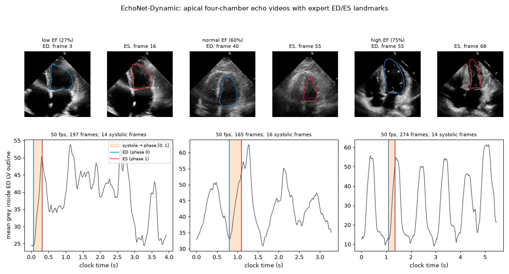
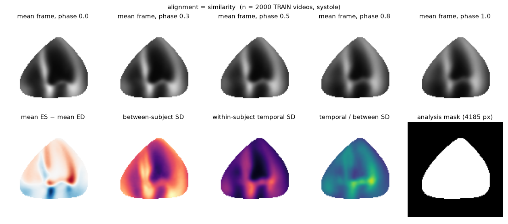

# EchoNet-Dynamic: MatFPCA of cardiac ultrasound videos

The design is in `PLAN.md`. This file records **what has been run and what
came out**. It is updated after each stage.

| Stage | Status | Date |
|---|---|---|
| Metadata check, Phase-0 go/no-go | done: **go** | 2026-11-23 |
| Preprocessing (`prepare_echonet.py`), three alignment modes | done | 2026-11-23 |
| Conversion to per-subject `rTensor` RDS | not started | |
| Pilot MatFPCA fit (56 × 56, n = 500, sparse) | not started | |
| Main fits, EF analysis, reconstruction | not started | |

## 1. The data in one figure



Each video is an apical four-chamber echocardiogram (112 × 112 pixels, usually
50 fps, several heartbeats). Experts traced the left ventricle (LV) on two
frames: **end-diastole (ED)**, when the LV is fullest, and **end-systole (ES)**,
when it is most contracted. Ejection fraction is EF = (EDV − ESV) / EDV.

Bottom row: the mean grey level inside the ED outline over the whole clip.
Blood is dark and muscle is bright, so the curve rises as the LV empties. The
expert ED and ES frames sit at the curve's minimum and peak. We keep the
systolic window (shaded) and map it to **cardiac phase t ∈ [0, 1]**
(ED → 0, ES → 1). Heart and frame rates differ between patients, so each
patient's frames fall on their own irregular set of phases.

## 2. Preprocessing

`prepare_echonet.py` (Python, PyAV) does the following for each video:

1. **Landmarks.** ED and ES come from `VolumeTracings.csv`. ED is the traced
   frame with the larger area. The ED long axis gives the apex and base points.
2. **Grey scale.** Grey is the mean of R, G and B.
3. **Overlay removal.** The fan is taken as the convex hull of the largest
   bright component of the clip's maximum projection. Everything outside it is
   set to 0. This removes the depth-scale ticks and the apex marker, which
   were the only colour pixels in ordinary videos.
4. **LV alignment** (optional, `--align`): one transform per video from the
   ED long axis. A single transform per video keeps the wall motion.
   - `none`: no transform.
   - `rigid`: rotate and translate the LV onto the canonical (median TRAIN)
     long axis; LV size is kept.
   - `similarity`: also scale the LV to the canonical length; size is removed.
     EF is a ratio, so it does not depend on size.
5. **Phase registration.** Keep frames ED…ES, set t = (frame − ED)/(ES − ED),
   and snap t to a 51-point grid (step 0.02).
6. **Analysis mask.** Keep pixels that lie inside the (aligned) fan in at
   least 90% of retained TRAIN videos.
7. **Normalisation scale.** For each video, record the mean in-mask grey
   level over its retained frames. The scale is stored but not applied.

**Why alignment is needed.** The ED tracings show that patients' hearts sit
in different places, and the differences are larger than the wall motion we
want to model (LV walls move about 5–8 px):

| ED long axis (5% / 50% / 95%) | Value |
|---|---|
| Length (px) | 44.9 / 56.4 / 74.4 |
| Tilt from vertical (°) | −1.5 / 13.4 / 27.3 |
| LV-centre spread (px), 5%–95% range | ~15 horizontal, ~24 vertical |

**Exclusions** (`report/qc_summary.csv`; identical for all alignment modes):

| Reason | Videos | TRAIN | VAL | TEST |
|---|---:|---:|---:|---:|
| **retained** | **9,672** | 7,206 | 1,235 | 1,231 |
| colour-map display (blue tint; in-fan colour > 5%) | 142 | 104 | 20 | 18 |
| ES traced before ED | 98 | 73 | 13 | 12 |
| implausible ED long axis (robust z > 4 on length or tilt) | 92 | 66 | 15 | 11 |
| ED→ES gap > 0.80 s | 15 | 10 | 2 | 3 |
| frame size not 112 × 112 | 6 | 5 | 0 | 1 |
| ED→ES gap < 0.10 s | 5 | 1 | 3 | 1 |

The retained videos have 6–48 systolic frames (median 17; 5%–95%: 12–24).
12.5% of them have EF < 40%. **No colour Doppler** was found: the coloured
videos use a blue display colour map over the whole image.

## 3. Phase-0 results (go/no-go)

`explore_echonet.py` uses 2,000 retained TRAIN videos, all VAL videos (for the
ridge penalty) and all TEST videos. These checks do **not** use MatFPCA yet:
for speed, frames are interpolated onto 11 phases, and the models are plain
PCA with ridge regression.


### 3.1 How much of the signal is temporal?

Shares of in-mask pixel variance on the registered systolic phase:

| Alignment | Mask px | Between-subject | Within-subject (temporal) | of which: mean dynamics μ(t) | of which: subject-specific |
|---|---:|---:|---:|---:|---:|
| none | 7,571 | 0.788 | **0.212** | 0.013 | 0.200 |
| rigid | 5,295 | 0.752 | **0.248** | 0.030 | 0.218 |
| similarity | 4,185 | 0.716 | **0.284** | 0.044 | 0.240 |

For comparison, in ADNI the leading temporal mode was constant and carried
99.0% of the temporal variance. Here 21–28% of all pixel variance is
within-subject change over the heartbeat, and most of it is subject-specific
rather than the shared mean motion. Alignment moves variance from
"between-subject" (largely misalignment) to dynamics. Dividing each video by
its normalisation scale adds about 1–3 points (`report/tables.md`).

### 3.2 Is EF carried by the motion?

EF on TEST from ridge regression on 50 PCA scores (penalty tuned on VAL; full
table for k = 10, 20, 50 in `report/tables.md`):

| Features (each is a PCA input) | none R² | rigid R² | similarity R² | similarity MAE | similarity AUC (EF < 40%) |
|---|---:|---:|---:|---:|---:|
| ED frame only (static) | 0.04 | 0.08 | 0.12 | 8.75 | 0.75 |
| Average over the frames (time discarded) | 0.09 | 0.16 | 0.27 | 8.06 | 0.83 |
| ES − ED difference image | 0.30 | 0.35 | 0.40 | 7.34 | 0.93 |
| Stacked video (11 phases, vectorised) | 0.19 | 0.38 | **0.47** | 6.95 | 0.92 |

The static ED frame predicts almost nothing (R² ≤ 0.12), so the concern that
EF is mostly heart size does not hold here. Every representation that keeps
the motion does much better. Alignment helps every row and doubles the
stacked-video R².

**What this means for the MatFPCA comparison:** with alignment, the
vectorised stacked-video PCA is a strong baseline (R² 0.47). MatFPCA should be
judged against it on EF, and above all on what dense PCA cannot do:
- work from sparse frames (3–8 per subject);
- separate the spatial and temporal structure in interpretable components;
- reconstruct held-out frames.

For reference, the published EchoNet-Dynamic deep model reports EF MAE of
about 4.1 on TEST. These unsupervised linear features are not expected to
match it.

### 3.3 Spatial maps

| No alignment | Similarity alignment |
|---|---|
|  |  |

(Rigid: `report/figures/variance_maps_rigid.png`.) After alignment the mean
frame is a sharp LV, and the mean ES − ED image shows the valve plane moving
toward the apex and the walls thickening. Temporal variation concentrates on
the septum, the lateral wall and the mitral annulus. Static between-subject
variation dominates the outer fan.

## 4. Decisions so far, and what is next

- **Default for the MatFPCA fits:** `similarity` alignment with gain
  normalisation. It has the largest temporal share, the best baselines and the
  cleanest mean.
- **Kept as sensitivity analyses:**
  - `rigid` keeps LV size, which is needed if ESV and EDV are prediction
    targets;
  - `none` is the minimal-preprocessing variant.
- **Next:**
  1. Convert frames to per-subject `rTensor` RDS files (p × q × m_i, masked,
     56 × 56 for the pilot).
  2. Fit the pilot (n = 500, sparse) and check the go/no-go criteria in
     PLAN.md §4.
  3. Main fits, EF analysis and reconstruction.

## 5. How to reproduce

```bash
# one-off environment (Compute Canada wheels)
module load python/3.11
python -m venv application/echonet/.venv
source application/echonet/.venv/bin/activate
pip install --no-index -r application/echonet/requirements.txt

# preprocessing (3 alignment modes, ~2 min each on 32 CPUs) + Phase-0 report
mkdir -p application/echonet/output
sbatch application/echonet/run_prepare.sbatch

# dataset figure (login node is fine, a few seconds)
python application/echonet/figure_dataset.py
```

Data are expected in `data/EchoNet-Dynamic/` (`Videos/`, `FileList.csv`,
`VolumeTracings.csv`).

| Output (in `output/prep_<mode>/`, not tracked) | Content |
|---|---|
| `frames/<id>.npz` | uint8 registered systolic frames, `frame_idx`, `phase`, `grid_idx`, `fan` |
| `videos.csv` | one row per video: labels, landmarks, QC, exclusion reason, `norm_scale` |
| `manifest.csv` | one row per systolic frame of retained videos (`retained` = kept after grid snapping) |
| `mask.npy`, `mask_coverage.npy`, `mask.png` | analysis mask |
| `qc_summary.csv`, `config.json` | exclusion counts, run settings, canonical long axis |

Tracked results are in `report/` (tables and figures).
