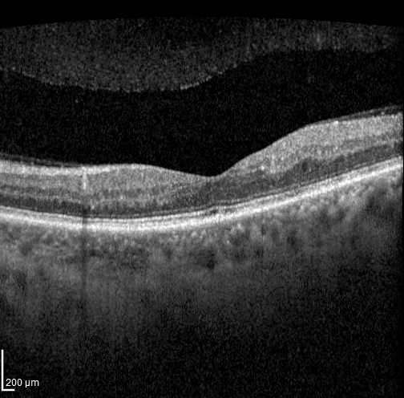
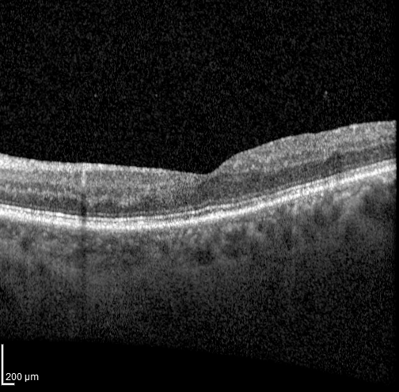
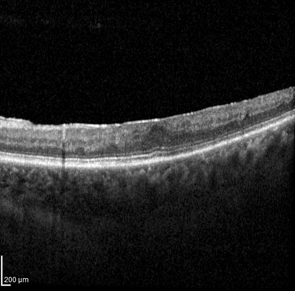
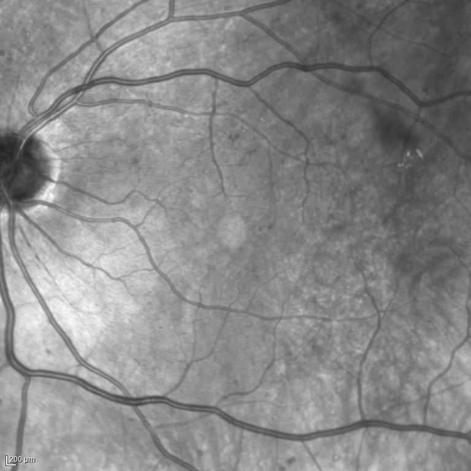
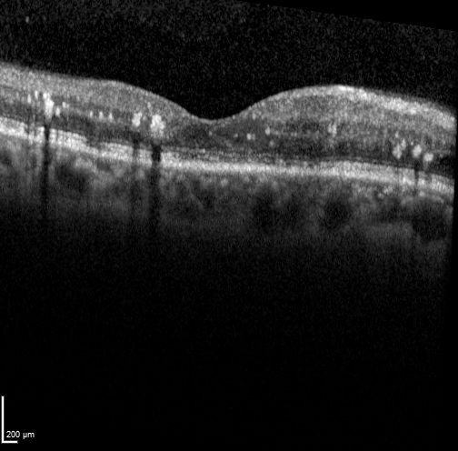
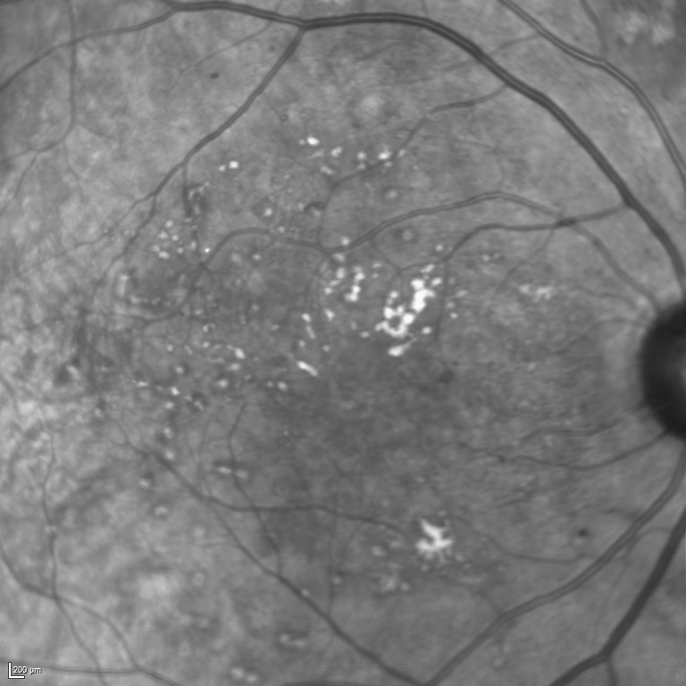

# Local OLIVES data: structure and examples

Inspected `data/OLIVES` on 2026-09-04. Counts below describe this local directory, including additional exports and derived arrays; they are not counts of unique scans in a curated release. The application [README](README.md) describes an earlier parquet copy and does not describe the current folder layout.

## Subjects and longitudinal measurements

**87 patients and 96 study eyes, confirmed by the local clinical label table**, correspond to 96 study folders: 40 PRIME folders and 56 TREX-DME folders spanning 47 patients. For example, `GILA/0213GOD` and `TREX/0213TOS` share a patient. All 96 folders map to a single clinical Eye_ID/Patient_ID pair each, although their image directories can also contain the fellow eye. The [official OLIVES documentation](https://github.com/olivesgatech/OLIVES_Dataset) describes longitudinal OCT/fundus imaging.

**Yes, these are repeated measurements.** PRIME uses week folders `W0`–`W104`; TREX-DME uses visit folders `V1`–`V27`. Availability varies by subject. PRIME has 3–21 observed weeks per folder; TREX-DME has 3–27 visits. Visit numbers should not be treated as elapsed weeks without a schedule/date table. Sort their numeric suffixes (`V2` before `V10`). Within one visit, the many OCT slices are spatial measurements, not separate time points.

| Cohort | Study folders | Visits per folder | Image files per folder | Total image files |
| --- | ---: | ---: | ---: | ---: |
| PRIME | 40 | 3–21 | 306–2,142 | 66,075 |
| TREX-DME / GILA | 22 | 10–25 | 1,020–2,550 | 33,533 |
| TREX-DME / TREX | 22 | 3–24 | 306–2,646 | 31,255 |
| TREX-DME / Monthly | 12 | 24–27 | 1,377–3,444 | 30,218 |
| **Total** | **96** | | | **161,081** |

Exact counts for every folder are in [subject_inventory.csv](subject_inventory.csv); counts aggregated by clinical Patient_ID are in [patient_inventory.csv](patient_inventory.csv). Per patient, there are **306–4,986 image files**, including both eyes and all exports. These are file counts, not independent observations or deduplicated images.

There are 1,596 folder/visit combinations and 3,143 image-containing eye/acquisition directories. Both `OD` (right eye) and `OS` (left eye) commonly occur inside a study folder—even when its name ends in one eye. There are also 24 directories named `OD 2` or `OS 2`; preserve these as separate acquisitions until their meaning is checked.

## Storage and image types

```text
data/OLIVES/
├── Prime_FULL/
│   └── 01-014/                     # patient/study folder
│       ├── sequence_62.npy
│       ├── sequence_3d_62.npy
│       └── W28/                    # week
│           ├── OD/                 # right eye
│           └── OS/                 # left eye
│               ├── 0.tif … 48.tif # OCT cross-sections
│               ├── fundus_W28.tif
│               ├── fundus_OS_W28.tif
│               └── volume_62_28.npy
└── TREX DME/
    ├── GILA/
    │   └── 0213GOD/
    │       └── V5/OD/
    │           ├── TREX_DME_000000.tif … TREX_DME_000048.tif
    │           ├── TREX_DME_001.tif
    │           ├── fundus_OD_V5.tif
    │           └── volume_4_5.npy
    ├── TREX/
    └── Monthly/
```

- **OCT:** grayscale retinal cross-sections. Inspected examples are 504 × 496 pixels, 8-bit grayscale, with a scale bar. A typical acquisition contains 49 B-scans. TREX filenames vary considerably; do not assume a single filename pattern.
- **Fundus/en-face views:** inspected examples are 768 × 768 pixels and look grayscale, including an RGB-encoded export. Multiple versions may coexist. There are 4,435 explicitly `fundus`-named files; other names can also represent fundus exports, so filename counts alone cannot give exact modality totals.
- **File formats:** 156,081 TIFF, 4,300 JPEG, and 700 PNG images, plus 1,783 NumPy `.npy` files. Most acquisition directories (3,120 of 3,143) contain 51 image files; 17 contain 99 and six contain 38–50. Thus “49 slices plus fundus” is typical, not universal.
- **Arrays:** 1,591 `volume_*.npy`, 96 `sequence_*.npy`, and 96 `sequence_3d_*.npy`. Example headers for subject `01-014` show uint8 shapes `(46,224,224)`, `(19,224,224)`, and `(18,46,224,224)`, respectively. These appear to be resized volume/sequence derivatives. Their generating code, filtering rules, axis meanings, and time-order mapping are not supplied here; sequence lengths need not equal the visible visit count. Do not treat arrays as extra subjects or assume complete visit coverage.

## Clinical and biomarker labels

Labels are available locally in the sibling folder [`data/OLIVES_Dataset_Labels`](../../data/OLIVES_Dataset_Labels), separate from the images:

| File | Contents |
| --- | --- |
| `ml_centric_labels/Clinical_Data_Images.xlsx` | 78,185 image rows; `File_Path`, `BCVA` (best-corrected visual acuity), `CST` (central subfield thickness), `Eye_ID`, `Patient_ID`; 87 unique patients and 96 unique eyes. |
| `ml_centric_labels/Biomarker_Clinical_Data_Images.csv` | 9,408 image rows; full image path, scan index, 16 biomarker fields, Eye_ID, Patient_ID, BCVA and CST. |
| `full_labels/OCT-DR.xlsx` | PRIME study sheets: Demographics, Data, CST, BCVA and DRSS; includes treatment and longitudinal measurements. |
| `full_labels/OCT-DME.xlsx` | Monthly/TREX/GILA study sheets, year-three sheets, and TREX/GILA vision sheets. |
| `full_labels/Summaries _DR_DME_Studies.docx` | Accompanying study-summary document. |

`full_labels` also contains byte-identical copies of the two image-level label tables; do not concatenate the copies.

**Join by full relative image path**, not basename: remove the leading `/` from `File_Path` and append it to `data/OLIVES/`. All **78,185 distinct clinical-table paths match local files**. The biomarker CSV uses the path column `Path (Trial/Arm/Folder/Visit/Eye/Image Name)`. Retain clinical Patient_ID for patient grouping and Eye_ID for study-eye grouping; parse week/visit from the matched path. The inventories now include confirmed clinical IDs. The image-level clinical table covers fewer images than the raw file inventory, so its labels should not automatically be assigned to every image in the same study folder, especially fellow-eye images.

No labels reside inside the image directory itself. No DICOM or parquet files were found there. Image counts come from a complete filename inventory; image dimensions and appearance were checked on examples, not every file.

## Example images

These PNG previews are direct TIFF-to-PNG conversions at original resolution, without enhancement. Paths below are relative to `data/OLIVES`. OCT panels sharing a slice number are not guaranteed to be spatially registered across visits.

**Same subject and eye over time:** `Prime_FULL/01-014/{W0,W28,W104}/OS/24.tif`.

| Week 0 | Week 28 | Week 104 |
| --- | --- | --- |
|  |  |  |

**Fundus and OCT examples:** the fundus views show the retinal surface and blood vessels; OCT shows a cross-section through retinal layers.

| PRIME fundus, week 28 | TREX-DME OCT, visit 5 | TREX-DME fundus, visit 5 |
| --- | --- | --- |
|  |  |  |

Sources: `Prime_FULL/01-014/W28/OS/fundus_OS_W28.tif`; `TREX DME/GILA/0213GOD/V5/OD/TREX_DME_000024.tif`; `TREX DME/GILA/0213GOD/V5/OD/fundus_OD_V5.tif`.
